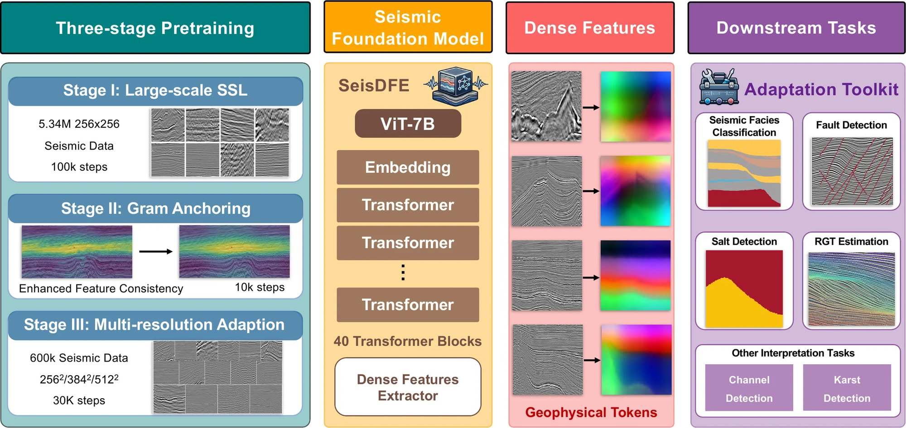

# SeisDFE: A Seismic Foundation Model for Dense Feature Extraction

🏢 [Computational Interpretation Group (CIG)](https://cig.ustc.edu.cn/main.htm)

[Zhixiang Guo](https://cig.ustc.edu.cn/guo/list.htm)1,2,3,
[Xinming Wu](https://cig.ustc.edu.cn/xinming/list.htm)1,2,3,*,
[Yimin Dou](https://cig.ustc.edu.cn/yimin/list.htm)1,2,3,
[Hui Gao](https://cig.ustc.edu.cn/hui/list.htm)4,
Siyao Zhao1,2,3,
He Huang1,2,3,
Wei Liu1,2,3

**English** | [简体中文](README.zh-CN.md)

<b>🏛 Affiliations</b>

1 Laboratory of Seismology and Physics of the Earth's Interior, School of Earth and Space Sciences, University of Science and Technology of China, Hefei, 230026, China

2 State Key Laboratory of Precision Geodesy, University of Science and Technology of China, Hefei, 230026, China

3 Mengcheng National Geophysical Observatory, University of Science and Technology of China, Hefei, 230026, China

4 Anhui University of Science and Technology, Huainan, Anhui, 232001, China

* Corresponding author: xinmwu@ustc.edu.cn

## 📰 News

- **2026.10:** The manuscript is under review.

## ✨ Introduction

High-quality annotations are scarce in seismic interpretation, and most deep-learning workflows still train a separate model for each task. <b>SeisDFE</b> is a 7B-parameter seismic foundation model for <b>dense feature extraction</b>. It is pretrained on <b>5.34 million</b> 2D seismic images derived from <b>more than 500</b> public 3D seismic volumes (over 200,000 km²), starting from DINOv3 ViT-7B. Three successive stages, discriminative self-supervised learning, Gram feature anchoring, and multi-resolution adaptation, make the patch-level features both discriminative and spatially coherent. With the encoder <b>frozen</b>, the same features support seismic facies classification, salt detection, fault detection, and relative geologic time (RGT) estimation, and extend to synthetic-to-field transfer and sparse 3D geobody detection.

<!-- 

  

<b>Figure 1.</b> Three-stage pretraining (left), the frozen ViT-7B encoder and its patch-level dense features (middle), and task-specific decoders for downstream interpretation (right).
 -->

**Highlights**

- 🧱 **Scale:** ViT-7B encoder with 40 Transformer blocks; single-channel patch embedding initialized from the channel mean of the RGB weights.
- 🔗 **Coherent dense features:** Gram anchoring restores the spatial coherence that degrades during prolonged self-supervised training.
- 🎯 **Label efficiency:** with only **2 annotated sections** on F3, whole-volume mIoU improves by about **12–19 percentage points** over the baselines.
- 🧊 **Frozen and reusable:** one frozen encoder serves facies, salt, faults, and RGT with lightweight heads, and extends to field data and sparse 3D interpretation.

## :bookmark: Citation

@misc{guo2026seismicfoundationmodeldense,
      title={A Seismic Foundation Model for Dense Feature Extraction}, 
      author={Zhixiang Guo and Xinming Wu and Yimin Dou and Hui Gao and Siyao Zhao and He Huang and Wei Liu},
      year={2026},
      eprint={2611.20745},
      archivePrefix={arXiv},
      primaryClass={cs.CV},
      url={https://arxiv.org/abs/2611.20745}, 
}

## :postbox: Contact

If you have any questions about this work, please feel free to contact xinmwu@ustc.edu.cn or zxg3@mail.ustc.edu.cn.

## 📄 License

Original SeisDFE code is released under the [MIT License](LICENSE). 
