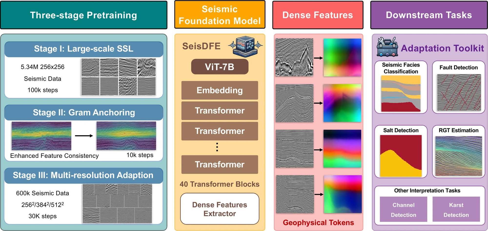

# SeisDFE：面向密集特征提取的地震基础模型

🏢 [计算解释组 (CIG)](https://cig.ustc.edu.cn/main.htm)

[Zhixiang Guo](https://cig.ustc.edu.cn/guo/list.htm)1,2,3,
[Xinming Wu](https://cig.ustc.edu.cn/xinming/list.htm)1,2,3,*,
[Yimin Dou](https://cig.ustc.edu.cn/yimin/list.htm)1,2,3,
[Hui Gao](https://cig.ustc.edu.cn/hui/list.htm)4,
Siyao Zhao1,2,3,
He Huang1,2,3,
Wei Liu1,2,3

**[🌐 项目主页](https://programmerzxg.github.io/SeisDFE/)**

[English](README.md) | **简体中文**

<b>🏛 作者单位</b>

1 中国科学技术大学 地球和空间科学学院 地震与地球内部物理实验室，合肥 230026

2 中国科学技术大学 精密测量国家重点实验室，合肥 230026

3 中国科学技术大学 蒙城地球物理国家野外科学观测研究站，合肥 230026

4 安徽理工大学，安徽淮南 232001

* 通讯作者：xinmwu@ustc.edu.cn

## 📰 动态

- **2026.10：** 论文审稿中。

## ✨ 简介

地震解释中高质量标注稀缺，而多数深度学习流程仍需针对每个任务单独训练模型。<b>SeisDFE</b> 是一个面向<b>密集特征提取</b>的 70 亿参数地震基础模型：以 DINOv3 ViT-7B 为起点，在源自 <b>500 余个</b>公开三维地震数据体（覆盖面积超过 20 万平方公里）的 <b>534 万张</b>二维地震图像上预训练。判别式自监督学习、Gram 特征锚定与多分辨率适配三个阶段依次进行，使 patch 级特征兼具判别性与空间一致性。在<b>冻结编码器</b>的条件下，同一套特征即可支撑地震相分类、盐体检测、断层检测与相对地质时间（RGT）估计，并可扩展到合成数据到实际资料的迁移以及稀疏标注下的三维地质体检测。

  

<b>图 1.</b> 三阶段预训练（左）、冻结的 ViT-7B 编码器及其 patch 级密集特征（中）、面向下游解释任务的任务解码器（右）。

**亮点**

- 🧱 **规模：** 含 40 个 Transformer 块的 ViT-7B 编码器；单通道 patch embedding 以 RGB 权重的通道均值初始化。
- 🔗 **空间一致的密集特征：** Gram 锚定恢复了长时间自监督训练中逐渐退化的空间一致性。
- 🎯 **标注高效：** 在 F3 上仅用 **2 张标注剖面**，全体积 mIoU 比各基线高约 **12–19 个百分点**。
- 🧊 **冻结即可复用：** 一个冻结编码器配合轻量预测头即可服务地震相、盐体、断层与 RGT，并可扩展到实际资料与稀疏三维解释。

## :bookmark: 引用

即将提供（Coming soon）。

## :postbox: 联系方式

如对本工作有任何问题，欢迎联系 xinmwu@ustc.edu.cn 或 zxg3@mail.ustc.edu.cn。

## 📄 许可证

SeisDFE 原创代码采用 [MIT 许可证](LICENSE)。DINOv3 衍生组件与模型权重沿用 [DINOv3 许可协议](licenses/DINOv3-LICENSE.md)，详见 [THIRD_PARTY_NOTICES.md](THIRD_PARTY_NOTICES.md)。论文图件与第三方数据集保留各自的适用条款。
