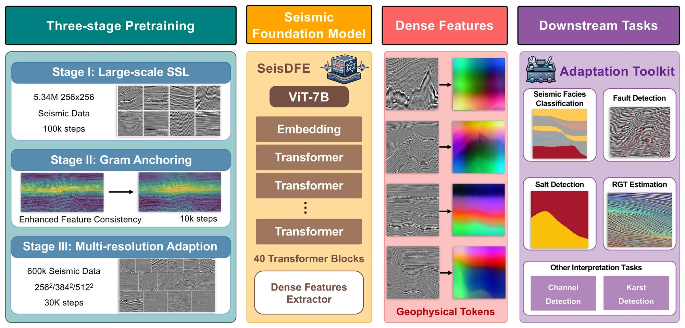
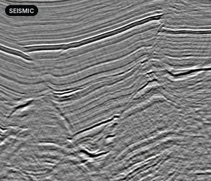
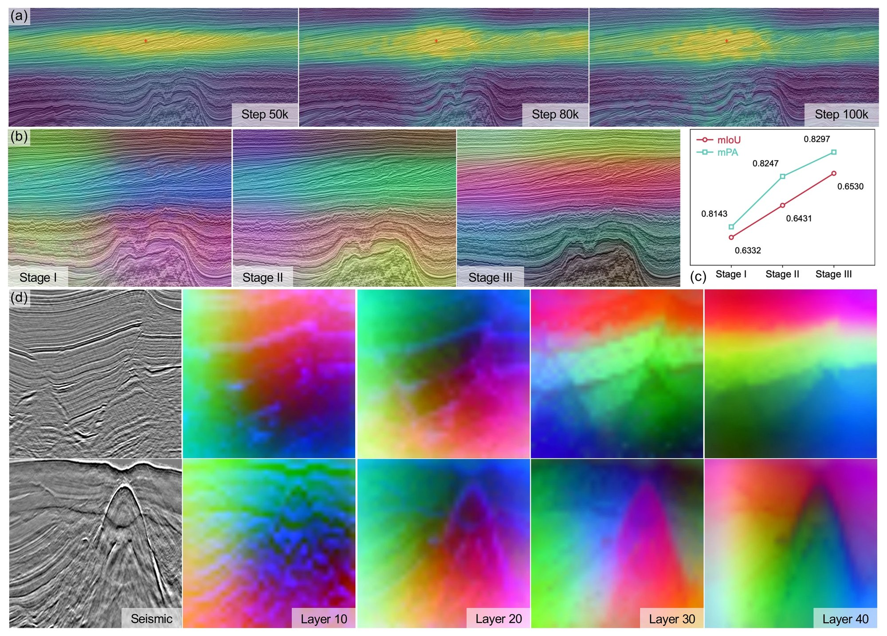
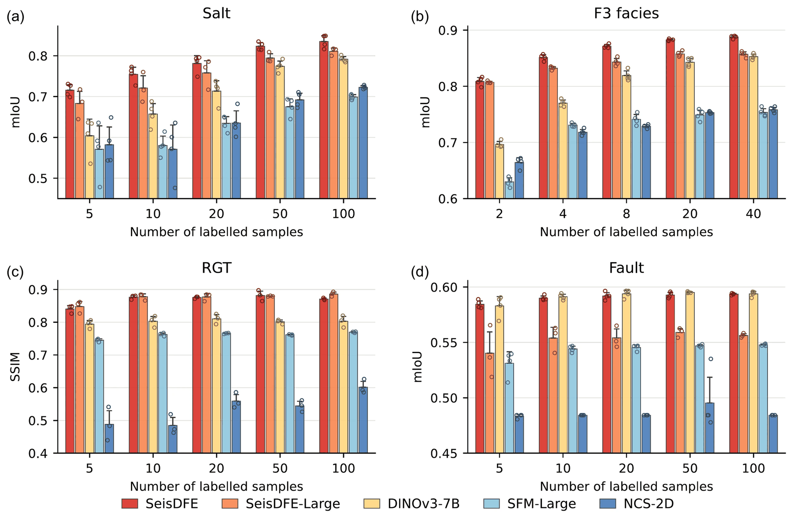
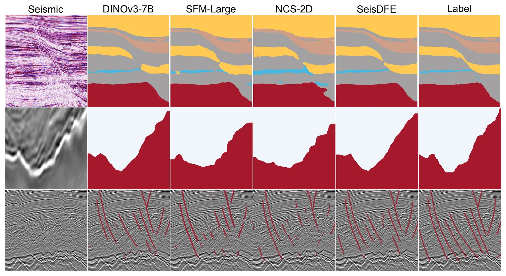
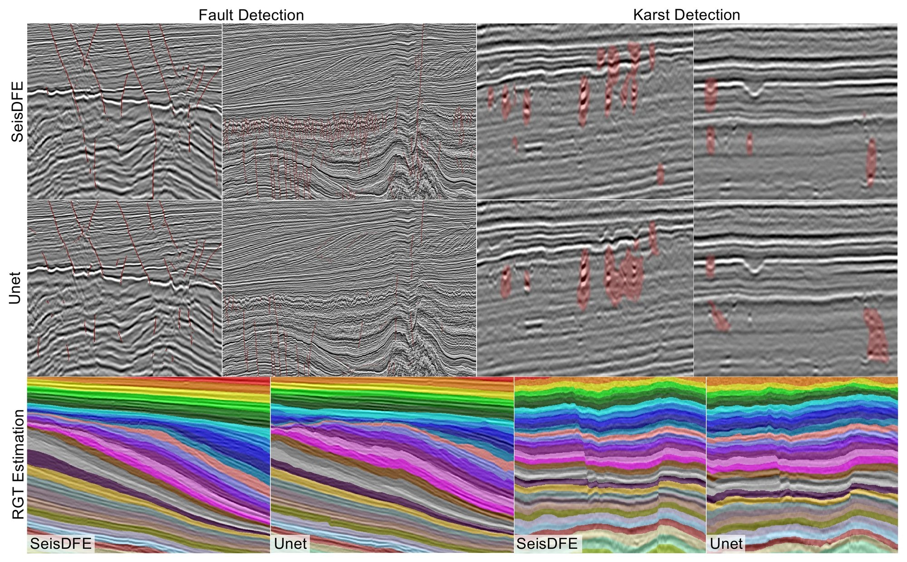
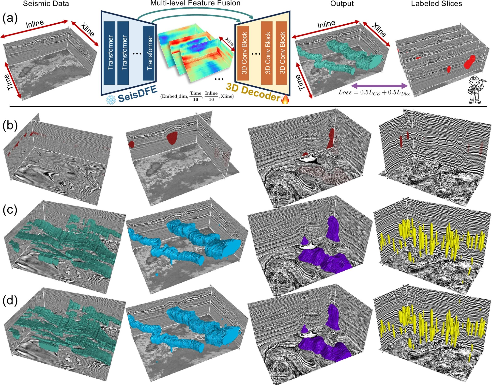

<div align="center">

# SeisDFE：面向密集特征提取的地震基础模型

🏢 [计算解释组 (CIG)](https://cig.ustc.edu.cn/main.htm)

[Zhixiang Guo](https://cig.ustc.edu.cn/guo/list.htm)<sup>1,2,3</sup>,
[Xinming Wu](https://cig.ustc.edu.cn/xinming/list.htm)<sup>1,2,3,*</sup>,
[Yimin Dou](https://cig.ustc.edu.cn/yimin/list.htm)<sup>1,2,3</sup>,
[Hui Gao](https://cig.ustc.edu.cn/hui/list.htm)<sup>4</sup>,
Siyao Zhao<sup>1,2,3</sup>,
He Huang<sup>1,2,3</sup>,
Wei Liu<sup>1,2,3</sup>

[](#seisdfe-citation)
[](#seisdfe-quick-start)
[](#seisdfe-models)
[](LICENSE)
[](https://github.com/ProgrammerZXG/SeisDFE/actions/workflows/tests.yml)

[English](README.md) | **简体中文**

</div>

<b>🏛 作者单位</b>

<sup>1</sup> 中国科学技术大学 地球和空间科学学院 地震与地球内部物理实验室，合肥 230026

<sup>2</sup> 中国科学技术大学 精密测量国家重点实验室，合肥 230026

<sup>3</sup> 中国科学技术大学 蒙城地球物理国家野外科学观测研究站，合肥 230026

<sup>4</sup> 安徽理工大学，安徽淮南 232001

<sup>*</sup> 通讯作者：xinmwu@ustc.edu.cn

## 📰 动态

- **2026.10.18：** 发布三阶段预训练、小样本训练、实际资料推理与 PCA 特征可视化代码。
- **2026.10：** 论文审稿中。
- **即将发布：** SeisDFE 编码器权重，以及断层 / RGT 实际资料推理头。

## ✨ 简介

<p align="justify">
地震解释中高质量标注稀缺，而多数深度学习流程仍需针对每个任务单独训练模型。<b>SeisDFE</b> 是一个面向<b>密集特征提取</b>的 70 亿参数地震基础模型：以 DINOv3 ViT-7B 为起点，在源自 <b>500 余个</b>公开三维地震数据体（覆盖面积超过 20 万平方公里）的 <b>534 万张</b>二维地震图像上预训练。判别式自监督学习、Gram 特征锚定与多分辨率适配三个阶段依次进行，使 patch 级特征兼具判别性与空间一致性。在<b>冻结编码器</b>的条件下，同一套特征即可支撑地震相分类、盐体检测、断层检测与相对地质时间（RGT）估计，并可扩展到合成数据到实际资料的迁移以及稀疏标注下的三维地质体检测。
</p>

<p align="center">
  
</p>
<p align="center"><sub><b>图 1.</b> 三阶段预训练（左）、冻结的 ViT-7B 编码器及其 patch 级密集特征（中）、面向下游解释任务的任务解码器（右）。</sub></p>

**亮点**

- 🧱 **规模：** 含 40 个 Transformer 块的 ViT-7B 编码器；单通道 patch embedding 以 RGB 权重的通道均值初始化。
- 🔗 **空间一致的密集特征：** Gram 锚定恢复了长时间自监督训练中逐渐退化的空间一致性。
- 🎯 **标注高效：** 在 F3 上仅用 **2 张标注剖面**，全体积 mIoU 比各基线高约 **12–19 个百分点**。
- 🧊 **冻结即可复用：** 一个冻结编码器配合轻量预测头即可服务地震相、盐体、断层与 RGT，并可扩展到实际资料与稀疏三维解释。

## 🔍 密集特征

<p align="center">
  
</p>
<p align="center"><sub>地震输入与 SeisDFE 第 10 → 20 → 30 → 40 层密集特征 PCA 的对比（取自图 2d）。PCA 颜色表示特征的组织方式，而非类别标签。</sub></p>

<p align="justify">
浅层特征突出局部振幅变化、反射纹理与构造边缘；中间层沿反射系统与地层变化组织特征；深层形成更大、更连续的区域，同时保留主要构造边界。在 SEAM 地震相分类上使用完全相同的冻结线性探测协议，每个阶段都提升了任务相关信息的可获取程度：
</p>

<div align="center">

| 检查点 | mIoU | mPA |
|:--|:--:|:--:|
| 第一阶段 · 大规模自监督 | 0.6332 | 0.8143 |
| 第二阶段 · Gram 锚定 | 0.6431 <sub>(+0.0099)</sub> | 0.8247 <sub>(+0.0104)</sub> |
| 第三阶段 · 多分辨率适配 | **0.6530** <sub>(+0.0198)</sub> | **0.8297** <sub>(+0.0154)</sub> |

</div>

<!-- Figure 2 temporarily hidden; remove this wrapper to restore.

<details>
<summary><b>图 2 · 密集地震表征的演化与组织</b></summary>
<br>
<p align="center"></p>
<p align="center"><sub>(a) 第一阶段 50k、80k、100k 步时的 patch 特征相似性；(b) 各阶段特征的 PCA；(c) SEAM 冻结线性探测；(d) 不同编码器深度特征的 PCA。</sub></p>
</details>

-->

<!-- Results temporarily hidden; remove this wrapper to restore.

## :stars: 实验结果

### 极端小样本线性探测

<p align="justify">
所有编码器均冻结，仅训练线性预测头，使用相同的训练样本与数据划分；数值为最小标注量下四次随机抽样的均值。
</p>

<div align="center">

| 任务（标注量） | 指标 | **SeisDFE** | DINOv3-7B | NCS-2D | SFM-Large |
|:--|:--:|:--:|:--:|:--:|:--:|
| TGS 盐体（5 张图像） | mIoU | **0.72** | 0.60 | 0.58 | 0.57 |
| F3 地震相（2 张剖面） | 全体积 mIoU | **0.82** | 0.70 | 0.66 | 0.63 |

</div>

<p align="center">
  
</p>
<p align="center"><sub><b>图 3.</b> (a) 盐体、(b) F3 地震相、(c) RGT（SSIM）与 (d) 断层的小样本线性探测结果，包含蒸馏得到的 SeisDFE-Large。</sub></p>

### 任务解码器

<p align="justify">
在更大训练集上，SeisDFE、SeisDFE-Large 与 DINOv3-7B 保持冻结；SFM-Large 与 NCS-2D 报告冻结与 LoRA 适配中验证表现更好的配置。
</p>

<div align="center">

<table>
  <thead>
    <tr><th align="left">编码器</th><th colspan="2">SEAM 地震相 · PUP</th><th colspan="2">TGS 盐体 · Linear</th><th colspan="2">断层 · MLA</th></tr>
    <tr><th></th><th>mIoU</th><th>mPA</th><th>mIoU</th><th>mPA</th><th>mIoU</th><th>mPA</th></tr>
  </thead>
  <tbody>
    <tr><td>DINOv3-7B <sub>冻结</sub></td><td align="center">0.8374</td><td align="center">0.9221</td><td align="center">0.8116</td><td align="center">0.8815</td><td align="center"><b>0.7564</b></td><td align="center"><b>0.8023</b></td></tr>
    <tr><td>SFM-Large <sub>LoRA</sub></td><td align="center">0.8243</td><td align="center">0.8994</td><td align="center">0.8044</td><td align="center">0.8773</td><td align="center">0.6361</td><td align="center">0.7062</td></tr>
    <tr><td>NCS-2D <sub>冻结 / LoRA</sub></td><td align="center">0.8415</td><td align="center">0.9121</td><td align="center">0.8046</td><td align="center">0.8767</td><td align="center">0.6468</td><td align="center">0.7165</td></tr>
    <tr><td>SeisDFE-Large <sub>冻结</sub></td><td align="center">0.8768</td><td align="center">0.9289</td><td align="center">0.8565</td><td align="center">0.9149</td><td align="center">0.7090</td><td align="center">0.7691</td></tr>
    <tr><td><b>SeisDFE</b> <sub>冻结</sub></td><td align="center"><b>0.8845</b></td><td align="center"><b>0.9324</b></td><td align="center"><b>0.8819</b></td><td align="center"><b>0.9297</b></td><td align="center">0.7374</td><td align="center">0.7867</td></tr>
  </tbody>
</table>

</div>

<p align="justify"><sub>NCS-2D 在地震相任务中冻结，在盐体与断层任务中使用 LoRA。断层是窄小的不连续结构，更依赖多层特征融合与解码器能力，该任务上 DINOv3-7B 略高。</sub></p>

<details>
<summary><b>代表性预测结果</b></summary>
<br>
<p align="center"></p>
<p align="center"><sub>行：SEAM 地震相、TGS 盐体、断层；列：地震数据、DINOv3-7B、SFM-Large、NCS-2D、SeisDFE、标签。</sub></p>
</details>

### 合成数据到实际资料的迁移

<p align="justify">
断层、溶洞与 RGT 模型仅用合成数据训练，并直接应用于未见过的实际工区，与在相同数据上训练的 U-Net 基线对比。断层与溶洞检测使用冻结编码器加 DPT 解码器；RGT 在编码器后 30 层加入 LoRA。由于缺少实际资料标签，该比较为定性结果。
</p>

<p align="center"></p>
<p align="center"><sub><b>图 4.</b> 实际资料上的断层检测（左上）、溶洞检测（右上）与 RGT 估计（下）：SeisDFE 与 U-Net 对比。</sub></p>

### 稀疏标注下的三维地质体检测

<p align="justify">
冻结的二维编码器分别提取相邻剖面的特征，融合后由轻量三维卷积解码器解码，仅用稀疏标注切片训练。示例包括河道（Parihaka、Romney）、盐丘（F3）以及实际工区中的溶洞。
</p>

<p align="center"></p>
<p align="center"><sub><b>图 5.</b> (a) 伪三维解码框架；(b) 稀疏标注；(c) 二维 PUP 预测；(d) 三维卷积解码器预测。</sub></p>

-->

<a id="seisdfe-models"></a>

## 🧠 模型

| 模型 | 结构 | 训练数据 | 状态 |
|:--|:--|:--|:--:|
| SeisDFE 编码器（第三阶段） | ViT-7B/16，40 块，单通道 | 534 万 + 60 万张无标签地震图像 | 即将发布 |
| 断层推理头 `fault_dpt.pth` | 冻结 SeisDFE + DPT | 合成断层数据 | 即将发布 |
| RGT 推理头 `rgt_dpt_lora.pth` | SeisDFE + DPT + LoRA（后 30 块） | 合成 RGT 数据 | 即将发布 |

权重不随代码分发，程序也不会自动下载。预训练需要原始 DINOv3-7B 权重，请按其条款从 [DINOv3 官方](https://github.com/facebookresearch/dinov3)获取。

<a id="seisdfe-quick-start"></a>

## :rocket: 快速开始

### 1. 安装

验证环境：Linux、Python 3.11、PyTorch 2.5.0、torchvision 0.20.0、CUDA 12.4。

```bash
git clone https://github.com/ProgrammerZXG/SeisDFE.git
cd SeisDFE
python -m venv .venv && source .venv/bin/activate
pip install torch==2.5.0 torchvision==0.20.0 --index-url https://download.pytorch.org/whl/cu124
pip install -e .
```

也可使用 [environment.yml](environment.yml)。以下命令均在仓库根目录执行。

### 2. 准备数据

剖面为 `float32` NumPy 数组，维度顺序为 **[深度/时间, 道]**。分割标签为 `0..C-1` 的整数（`255` 表示忽略）；RGT 标签为浮点数。请**先**按工区划分训练/验证，再生成切片与裁剪。

```text
data/
├── pretrain/
│   ├── 256/images/<survey>/<section>.npy   # [256, 256]
│   └── 512/images/<survey>/<section>.npy   # [512, 512]
└── downstream/<task>/                     # salt | facies | fault | rgt
    ├── train/{images,labels}/<id>.npy
    └── val/{images,labels}/<id>.npy
```

### 3. 三阶段预训练

将 DINOv3-7B 初始化权重放在 `checkpoints/dinov3_vit7b16.pth`。配置保留原实验 100k / 10k / 30k 步的训练计划。

```bash
seisdfe-index --root data/pretrain/256/images --output data/pretrain/256/index --validate
seisdfe-index --root data/pretrain/512/images --output data/pretrain/512/index --validate

for s in 1 2 3; do
  torchrun --standalone --nproc_per_node=8 -m seisdfe.cli.pretrain \
    --config configs/pretrain/stage${s}.yaml --output outputs/stage${s}
done
```

<details>
<summary>预训练说明</summary>

- 第一阶段将 RGB patch embedding 沿通道求均值，以适配单通道输入。
- 第二阶段加载第一阶段最终的 EMA teacher；第三阶段加载第二阶段的，并使用 256 / 384 / 512 裁剪训练。
- GPU 数量会影响有效批量与学习率缩放。
- 续训同一次实验使用 `--resume`，检查路径使用 `--dry-run`，并支持 `train.batch_size_per_gpu=2` 等点号覆盖。
- 第三阶段的 DCP 目录（如 `outputs/stage3/ckpt/29999`）或合并后的 `.pth` 均可直接作为编码器权重。

</details>

### 4. 小样本训练

```bash
seisdfe-train --config configs/downstream/salt_fewshot.yaml \
  encoder.weights=checkpoints/seisdfe_stage3.pth \
  data.root=data/downstream/salt train.shots=5 train.seed=3407 \
  train.output=outputs/salt_5shot
```

<details>
<summary>解码器、LoRA 与输出文件</summary>

- `decoder.type=linear|conv|pup|mla|dpt`；MLA 与 DPT 使用四层特征。
- LoRA 示例：`decoder.type=dpt lora.enabled=true lora.last_n_blocks=8 lora.rank=8 lora.alpha=16`。
- RGT 默认仅用最后一层；切换 DPT 时同时设置 `encoder.layers=[9,19,29,39] decoder.n_bins=256`。
- 严格仿射线性探测：`decoder.type=linear decoder.use_batchnorm=false decoder.dropout=0 lora.enabled=false`。
- 每次训练保存 `config.yaml`、`train_ids.txt`、`data_manifest.json`、`environment.json`、`metrics.jsonl`、`best.pth` 与 `last.pth`。续训使用 `--resume outputs/<run>/last.pth`；固定训练子集使用 `train.subset_file=ids.txt`。

这套便携配置保留了主要的解码器、归一化与损失设置，但没有重建原论文的全部数据划分与增强。

</details>

### 5. 推理

```bash
seisdfe-infer --checkpoint checkpoints/fault_dpt.pth \
  --encoder-config configs/encoder/vit7b.yaml \
  --encoder-weights checkpoints/seisdfe_stage3.pth \
  --input data/field/section.npy --output outputs/field_fault
```

RGT 推理将推理头换成 `checkpoints/rgt_dpt_lora.pth` 即可，也可使用任意小样本训练得到的 `best.pth`。输入可以是单个 NPY/NPZ 剖面，或包含 NPY 剖面的目录。

<details>
<summary>推理选项</summary>

- `--mode native|resize|fault-tiles|rgt-lateral`，`--window 512 --overlap 256`。
- 断层采用重叠分块与最大概率融合；RGT 采用全深度横向滑窗与余弦加权融合。
- 输出保持输入的 H×W 尺寸。分箱 RGT 头输出 [0, 1] 范围内的相对地质时间，不能直接解释为绝对年龄。
- CPU 运行使用 `--device cpu --precision fp32`。7B 编码器与 MLA 解码器的内存开销较大。

</details>

### 6. PCA 特征可视化

```bash
seisdfe-pca --encoder-config configs/encoder/vit7b.yaml \
  --encoder-weights checkpoints/seisdfe_stage3.pth \
  --input data/field/section.npy --layers 9 19 29 39 --output outputs/pca
```

层号从 **0** 开始。若要在不同剖面间保持一致的配色，可通过 `--layers 39 --basis outputs/pca/layer_39_basis.npz` 复用单层 PCA 基底，并指定新的 `--output` 目录。

<details>
<summary>代码结构与测试</summary>

```text
seisdfe/             # data, models, training, inference, PCA, CLI
dinov3/              # required DINOv3 core, original names retained
configs/pretrain/    # three recorded stage configurations
configs/downstream/  # portable few-shot task configurations
configs/encoder/     # ViT-7B architecture
tests/               # CPU tests and a CUDA three-stage smoke test
```

```bash
CUDA_VISIBLE_DEVICES="" python -m unittest discover -s tests -v
CUDA_VISIBLE_DEVICES=0 python tests/pretrain_smoke.py   # optional, CUDA
```

</details>

<a id="seisdfe-citation"></a>

## :bookmark: 引用

即将提供（Coming soon）。

## :memo: 致谢

本研究得到国家自然科学基金（NSFC，批准号 42625404）资助。代码基于 [DINOv3](https://github.com/facebookresearch/dinov3) 构建，并使用了 [LoRA](https://github.com/microsoft/LoRA)。感谢 USGS、SEG、NZPAM、NLOG 等公开数据库提供预训练所用的地震数据体，感谢 [SEAM](https://www.aicrowd.com/challenges/seismic-facies-identification-challenge)、[TGS](https://www.kaggle.com/competitions/tgs-salt-identification-challenge) 与 [F3 地震相基准](https://github.com/yalaudah/facies_classification_benchmark)提供下游数据集。

## :postbox: 联系方式

如对本工作有任何问题，欢迎联系 xinmwu@ustc.edu.cn 或 zxg3@mail.ustc.edu.cn。

## 📄 许可证

SeisDFE 原创代码采用 [MIT 许可证](LICENSE)。DINOv3 衍生组件与模型权重沿用 [DINOv3 许可协议](licenses/DINOv3-LICENSE.md)，详见 [THIRD_PARTY_NOTICES.md](THIRD_PARTY_NOTICES.md)。论文图件与第三方数据集保留各自的适用条款。
